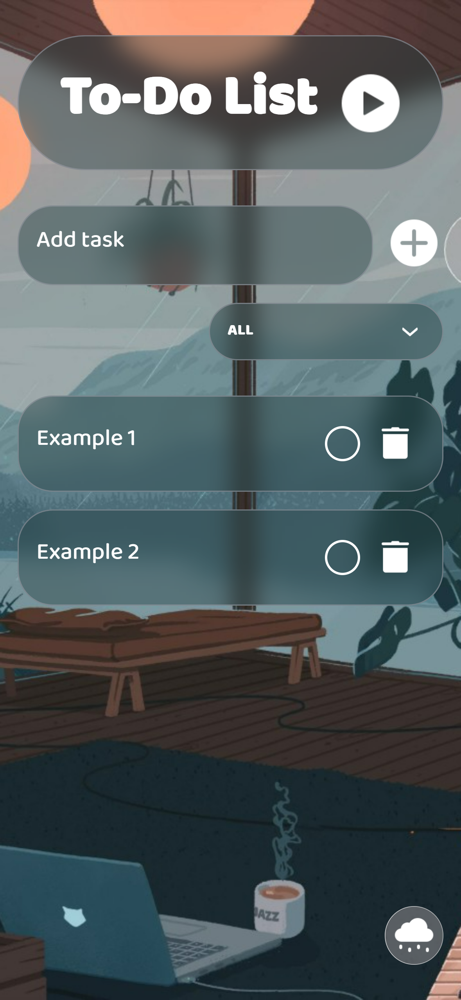
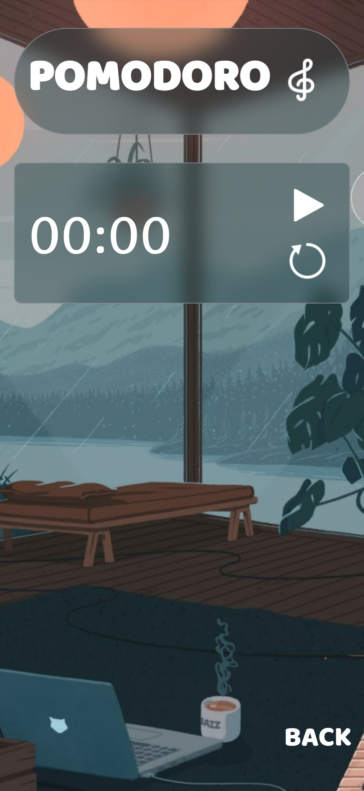

# To-Do List with Pomodoro Timer

A task management app with a built-in Pomodoro timer and three theme options. Works as a web app and as an Android APK.

## Demo
- **Android APK:** [Release] (https://github.com/PlayerFront/todo-ts/releases/tag/v1.0.0)

## Screenshots



## Features

- Add, delete, and mark tasks as completed
- Filter tasks: all / completed / incomplete
- Automatic saving of tasks to `localStorage`
- Three theme options with smooth switching
- Built-in Pomodoro timer
- Responsive design (mobile, tablet)
- Android APK build via Capacitor

## Design from Figma Community
- **Design:** [Navya Durga](https://www.figma.com/@lifeneedfantasy)

## Tech Stack

| Technology | Purpose |
|---|---|
| **React 19** | UI library |
| **TypeScript** | Type safety |
| **Vite** | Build tool and dev server |
| **CSS** | Styling |
| **Vitest + RTL** | Testing |
| **Capacitor** | Android APK build |

## Project Structure
src/
├── components/ # React components
│ ├── AddTaskForm.tsx
│ ├── CustomSelect.tsx
│ ├── TaskItem.tsx
│ ├── TaskList.tsx
│ ├── ThemeToggle.tsx
│ └── Timer.tsx
├── hooks/ # Custom hooks
│ └── useLocalStorage.ts
├── types/ # TypeScript types
│ └── task.ts
├── utils/ # Utility functions
│ └── filterTasks.ts
├── assets/ # Icons, fonts, images
├── App.tsx # Root component
└── main.tsx # Entry point

## Tests

The project is covered with tests (Vitest + React Testing Library):

```bash
npm run test      
npm run test:run    

Getting Started

# Install dependencies
npm install

# Dev server
npm run dev

# Build
npm run build

# Tests
npm run test

# Android APK build
npm run build
npx cap sync
cd android
./gradlew assembleDebug

Android APK
The APK is built with Capacitor. The ready file is located at:

android/app/build/outputs/apk/debug/app-debug.apk
